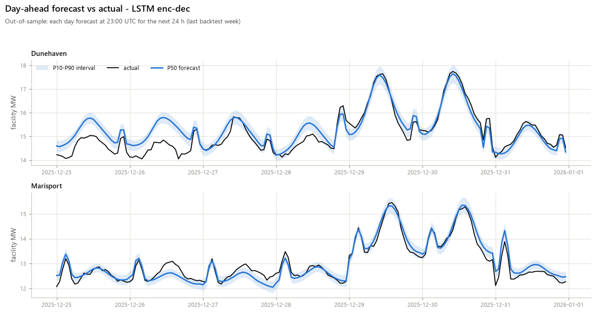
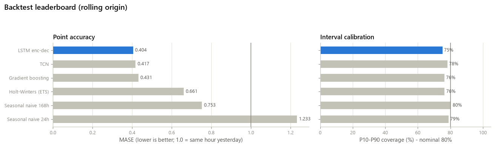
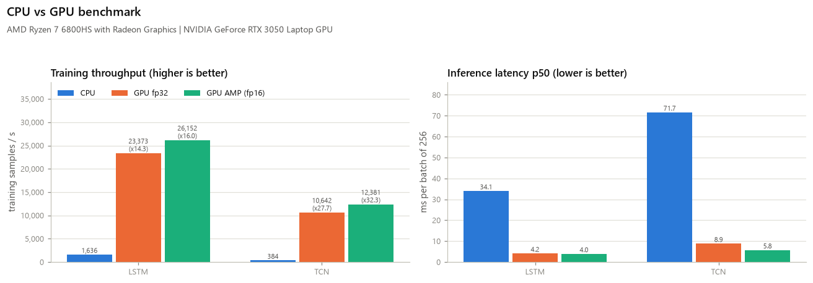
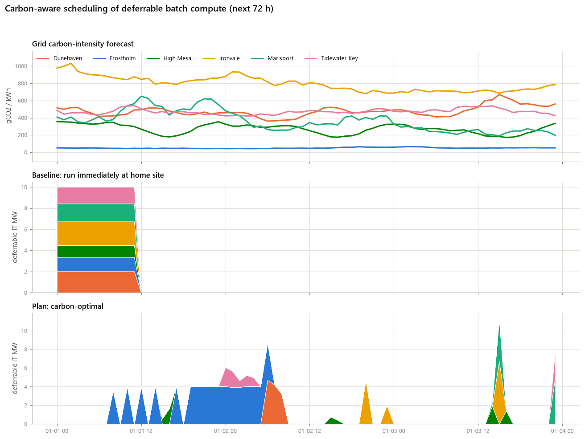
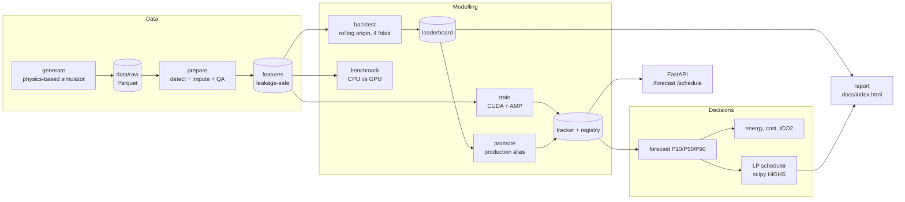
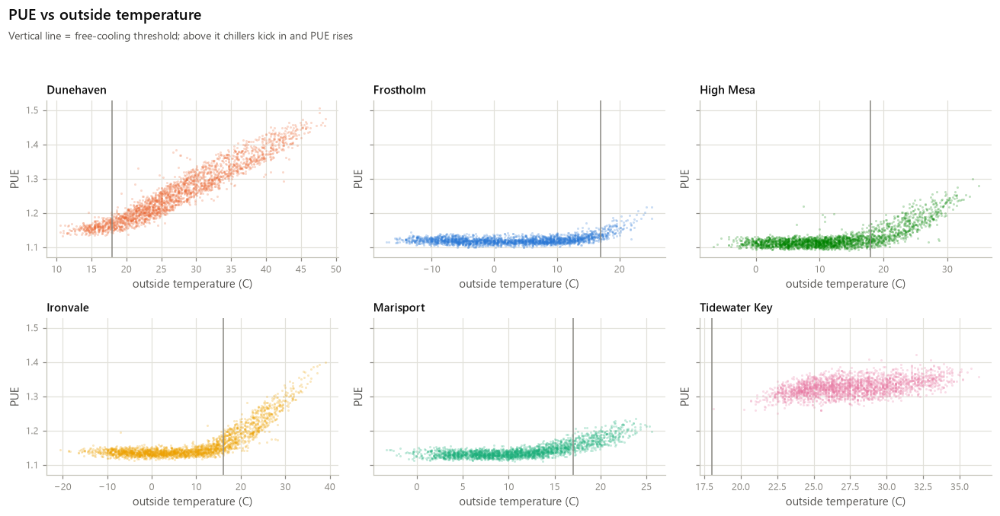
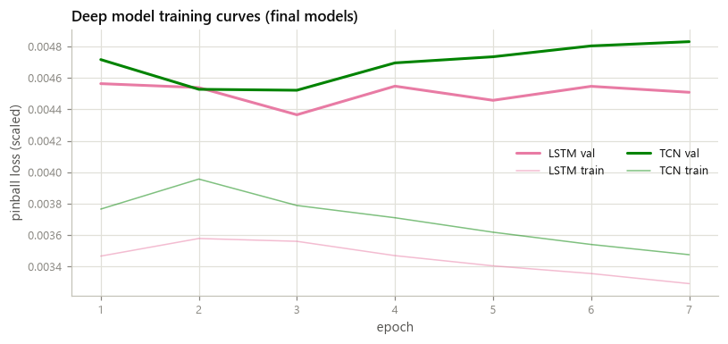
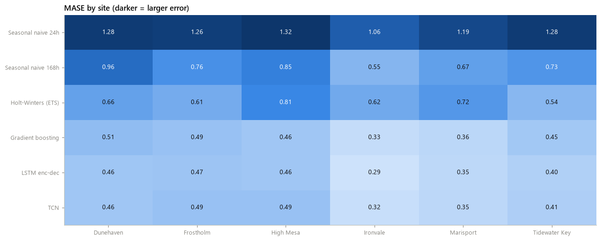

# datacenter-energy-forecasting

[](https://github.com/ADU773/datacenter-energy-forecasting/actions/workflows/ci.yml)
[](https://www.python.org/)
[](LICENSE)

**GPU-accelerated forecasting of data-center power demand for a fictional cloud operator,
Helios Cloud (6 sites in very different climates), turned into business decisions: energy,
cost, carbon, and carbon-aware scheduling of deferrable compute.** A physics-motivated simulator
produces three years of hourly telemetry (IT load, weather, PUE, grid carbon intensity, power
prices) with realistic sensor faults; a QA step detects and imputes them; six models - from
seasonal-naive baselines to an LSTM encoder-decoder and a Temporal Convolutional Network trained
on CUDA with mixed precision - are compared in a rolling-origin backtest with probabilistic
(P10/P50/P90) metrics; and a linear program places deferrable batch compute into low-carbon hours
and sites. Everything is tracked, served over FastAPI and published as a static report.

**Live report:** https://adu773.github.io/datacenter-energy-forecasting/ &nbsp;|&nbsp;
[Architecture](docs/architecture.md) &nbsp;|&nbsp; [Data generation](docs/data-generation.md)
&nbsp;|&nbsp; [Data dictionary](docs/data-dictionary.md)



## Highlights / key results

All numbers come from `dcforecast run-all` (default profile) on a Ryzen 7 6800HS laptop with an
RTX 3050 Laptop GPU (4 GB), recorded in [docs/metrics.json](docs/metrics.json) and `reports/`.

- **Accurate day-ahead forecasts:** the production LSTM reached **1.29% MAPE and MASE 0.40** over
  4 backtest folds (15,769 hourly points) - **47% lower MAE than the weekly seasonal-naive
  baseline**. On the final 72-hour horizon, total forecast energy was within **0.4%** of actual,
  and the P10-P90 band covered **80.3%** of hours (nominal 80%).
- **GPU speed-up:** training throughput on the RTX 3050 was **16x (LSTM) and 32x (TCN) faster than
  the 8-thread CPU** with AMP; mixed precision added 12-16% over fp32 and **roughly halved
  training VRAM** (LSTM 1,667 MB -> 861 MB).
- **Carbon-aware scheduling:** moving 120 MWh of deferrable compute with an LP cut emissions by
  **59% (40.3 tCO2) while also saving 3% on cost**; a blended plan priced at $85/tCO2 saved
  **58% of CO2 and 18% of cost**. Evaluated against realised (not forecast) carbon, the savings
  held at 55%.
- **Data quality:** the cleaning step detected injected sensor spikes with 95% recall and stuck
  sensors with 99% recall at **99.9% precision**; imputed facility power was off by only 1.5% MAPE.
- **Whole pipeline in ~12 minutes** (741 s) on a laptop: generate, clean, 4-fold backtest of 6
  models, final training, CPU/GPU benchmark, decisions and report.

### Backtest leaderboard (4 folds x 4 weeks, 24-hour-ahead, all 6 sites)

| Rank | Model | MAE (kW) | RMSE (kW) | MAPE | MASE | Pinball | P10-P90 coverage |
|---:|---|---:|---:|---:|---:|---:|---:|
| 1 | **LSTM encoder-decoder** (PyTorch) | **164.4** | **271.0** | **1.29%** | **0.404** | **53.7** | 75.1% |
| 2 | TCN (PyTorch) | 169.2 | 276.3 | 1.33% | 0.417 | 55.1 | 78.2% |
| 3 | Gradient boosting (quantile) | 177.1 | 284.9 | 1.37% | 0.431 | 58.2 | 76.4% |
| 4 | Holt-Winters / ETS | 275.9 | 462.7 | 2.13% | 0.661 | 94.3 | 76.5% |
| 5 | Seasonal naive (168 h) | 311.5 | 517.4 | 2.38% | 0.753 | 111.1 | 80.4% |
| 6 | Seasonal naive (24 h) | 511.2 | 796.1 | 3.91% | 1.233 | 181.3 | 78.9% |

MASE is scaled by the in-sample weekly seasonal-naive error; pinball is the mean quantile loss
over P10/P50/P90.



## CPU vs GPU benchmark

Batch 1,024, lookback 168 h, horizon 24 h ([reports/benchmark.json](reports/benchmark.json)).

| Model | Device | Train samples/s | Epoch (60k samples) | Peak train VRAM | Inference p50 / p95 (batch 256) | Mean GPU util |
|---|---|---:|---:|---:|---:|---:|
| LSTM | CPU (8 threads) | 1,636 | 36.7 s | - | 34.1 / 39.8 ms | - |
| LSTM | CUDA fp32 | 23,373 | 2.6 s | 1,667 MB | 4.2 / 4.5 ms | 83% |
| LSTM | CUDA AMP | **26,153** | **2.3 s** | **861 MB** | 4.0 / 4.7 ms | 38% |
| TCN | CPU (8 threads) | 384 | 156.4 s | - | 71.7 / 118.5 ms | - |
| TCN | CUDA fp32 | 10,642 | 5.6 s | 1,116 MB | 8.9 / 9.4 ms | 56% |
| TCN | CUDA AMP | **12,381** | **4.9 s** | **634 MB** | 5.8 / 6.2 ms | 67% |



## Carbon-aware scheduling

120 MWh of deferrable batch compute must run in the next 72 hours; up to half of it may move to
another site. An LP (`scipy.optimize.linprog`, HiGHS) places it subject to each site's power
headroom.

| Plan | tCO2 | CO2 saved | Cost | Cost saved | CO2 saved (realised) |
|---|---:|---:|---:|---:|---:|
| Run immediately (baseline) | 68.3 | - | $8,287 | - | - |
| Carbon-optimal, time-shift only | 50.9 | 25.5% | $10,563 | -27.5% | 17.9% |
| **Carbon-optimal (time + site)** | **28.0** | **59.0%** | **$8,037** | **3.0%** | **54.8%** |
| Cost-optimal | 88.7 | -29.9% | $6,657 | 19.7% | -32.9% |
| Blended ($85/tCO2) | 29.0 | 57.6% | $6,804 | 17.9% | 53.1% |

The finding: time-shifting alone helps carbon but costs more, because low-carbon hours are
not always cheap. Letting work move between sites gives most of the carbon benefit and saves
money too, and a modest carbon price picks a plan that is close to best on both.



## Architecture



## The data

Six fictional sites (Dunehaven, Frostholm, High Mesa, Ironvale, Marisport, Tidewater), hourly
from 2023-01-01 to 2025-12-31: **157,824 site-hours**. The generator models:

- **IT load** with business-hour and weekly cycles, long-term growth, product launches, nightly
  batch windows, holidays and random incidents
- **Weather**: a seasonal climate model per site plus AR(1) noise for temperature and humidity
- **PUE** as a function of temperature (free-cooling vs chiller regime), so
  facility power = IT load x PUE
- **Grid carbon intensity** with a solar dip and a site-specific mix (from ~49 to ~475 gCO2/kWh on
  average), plus **time-of-use power prices**
- **Sensor faults**: gaps, outages, spikes and stuck values, which the `prepare` step detects and
  imputes



Details are in [docs/data-generation.md](docs/data-generation.md); column definitions are in
[docs/data-dictionary.md](docs/data-dictionary.md).

## How it uses system resources

| Resource | How |
|---|---|
| **GPU** | Device auto-detection (CUDA -> MPS -> CPU); `torch.autocast` + `GradScaler` mixed precision; pinned memory; a **VRAM-aware batch-size finder** that halves on OOM and stays inside the 4 GB RTX 3050 shared with the desktop; GPU utilisation and memory sampled from `nvidia-smi` during the benchmark. |
| **CPU** | The CPU baseline uses 8 threads (~7.6 cores busy on average); gradient boosting and ETS run on CPU; the API serves forecasts on CPU by default. |
| **RAM** | The full pipeline peaked at 2.7 GB RSS; the benchmark samples CPU% and RSS with psutil. |
| **Storage** | Parquet for raw and processed data (31.8 MB), SQLite experiment tracker + model registry (10 MB), static report under `docs/` (1.9 MB). |

`dcforecast hw` prints what was detected:

```text
Host           : host-01 (anonymised)
OS / Python    : Windows 11 / Python 3.14.3 / torch 2.11.0+cu128
CPU            : AMD Ryzen 7 6800HS with Radeon Graphics
CPU cores      : 8 physical / 16 logical
RAM            : 14.8 GB total, 3.4 GB available
Accelerator    : cuda
GPU 0          : NVIDIA GeForce RTX 3050 Laptop GPU
  VRAM         : 4.00 GB total, 3.23 GB free
  CUDA (torch) : 12.8
  Driver       : 616.92
  Compute cap. : 8.6
```



## Quickstart

**Windows (PowerShell)**

```powershell
git clone https://github.com/ADU773/datacenter-energy-forecasting.git
cd datacenter-energy-forecasting
python -m venv .venv
.\.venv\Scripts\Activate.ps1
# NVIDIA GPU: install a CUDA build of PyTorch first, e.g.
pip install torch --index-url https://download.pytorch.org/whl/cu128
pip install -e ".[dev]"
dcforecast hw
dcforecast -c tiny run-all     # ~1 minute on CPU
dcforecast run-all             # full pipeline, ~12 minutes on a laptop GPU
```

**macOS / Linux**

```bash
git clone https://github.com/ADU773/datacenter-energy-forecasting.git
cd datacenter-energy-forecasting
python -m venv .venv && source .venv/bin/activate
pip install -e ".[dev]"
dcforecast hw
dcforecast -c tiny run-all
dcforecast serve               # http://127.0.0.1:8000/docs
```

## CLI reference

| Command | Purpose |
|---|---|
| `dcforecast hw` | Print CPU / RAM / GPU information |
| `dcforecast generate` | Generate the synthetic raw dataset |
| `dcforecast prepare` | Detect and impute sensor faults, build features, QA report |
| `dcforecast backtest` | Rolling-origin backtest of all models + leaderboard |
| `dcforecast train --model lstm --device cuda` | Train final models on all history and register them |
| `dcforecast benchmark` | CPU vs GPU (fp32 / AMP) training and inference benchmark |
| `dcforecast runs {list,compare,show,models}` | Experiment tracker |
| `dcforecast promote` | Set the `production` alias (best backtest model by default) |
| `dcforecast forecast` | Forecast the next hours with a registered model |
| `dcforecast schedule` | Carbon-aware placement of deferrable compute |
| `dcforecast serve` | FastAPI service (uvicorn) |
| `dcforecast report` | Build `docs/index.html` and `docs/images/*.png` |
| `dcforecast run-all` | The whole pipeline end to end |

Global options: `-c/--config` (`default`, `tiny` or a YAML path; env `DCF_CONFIG`),
`--set key=value` overrides (e.g. `--set deep.epochs=5`), `--log-level`.

### API

| Endpoint | Description |
|---|---|
| `GET /health` | Status, device, loaded production model |
| `GET /models` | Registered models and aliases |
| `GET /forecast?site=frostholm&horizon=24` | P10/P50/P90 hourly forecast |
| `GET` / `POST /schedule` | Carbon-aware plan for a given deferrable volume |

## Modelling details

- **Leakage-safe features:** calendar and holiday flags, Fourier terms, lags of 24/48/168 h and
  rolling statistics computed only from the past. Weather is treated as a known forecast at
  prediction time (documented assumption).
- **One interface** (`fit/predict/save/load`) for every model, so backtest, registry and API treat
  them the same way.
- **Deep models:** global multi-site networks with a site embedding, 168-hour lookback, direct
  24-hour multi-horizon output, pinball loss on three quantiles, gradient clipping, a OneCycle LR
  schedule, early stopping, best-checkpoint saving and deterministic seeds.
- **Evaluation:** 4 rolling-origin folds, each a 4-week test window with a daily forecast origin;
  MAE, RMSE, MAPE, sMAPE, MASE, pinball loss and interval coverage, overall and per site.



## Project structure

```text
datacenter-energy-forecasting/
├── src/dcforecast/
│   ├── data/          # site definitions, generator, cleaning + QA, calendar
│   ├── features.py    # leakage-safe feature engineering
│   ├── models/        # baselines, ETS, gradient boosting, deep/ (LSTM, TCN, trainer, batch-size finder)
│   ├── evaluation/    # metrics, rolling-origin backtest
│   ├── tracking/      # SQLite experiment tracker + model registry
│   ├── decision/      # energy/cost/carbon rollup, LP scheduler
│   ├── api/           # FastAPI app and schemas
│   ├── report/        # Plotly report and matplotlib charts
│   ├── configs/       # default.yaml, tiny.yaml
│   ├── benchmark.py  hardware.py  pipeline.py  cli.py
├── tests/             # 76 pytest tests (tiny config, CPU; GPU tests skip without CUDA)
├── docs/              # GitHub Pages report, images, metrics.json, design docs
├── reports/           # JSON/CSV outputs of the default run
├── Dockerfile  Makefile  pyproject.toml
```

## Testing and CI

```bash
pytest -q                     # 76 tests, ~45 s
ruff check . && ruff format --check .
```

GitHub Actions runs ruff, installs CPU-only PyTorch and runs the test suite on Python 3.11 and 3.12
with a CLI smoke test, then builds and smoke-tests the Docker image.

## Design decisions and trade-offs

- **Synthetic but physical data:** real multi-site data-center telemetry is not public, so the
  simulator encodes the drivers that matter (load cycles, climate-driven PUE, grid mix). That keeps
  the project reproducible and lets the QA step be scored against known injected faults.
- **Global deep models:** one network across all sites with a site embedding shares statistical
  strength and is cheaper to train and serve than six separate models.
- **Probabilistic forecasts:** P10/P90 feed the decision layer, so energy and carbon are reported
  as ranges, not single numbers.
- **LP over heuristics:** the scheduler is a small linear program with exact capacity constraints,
  solvable in milliseconds with HiGHS.
- **Honest limitations:** the deep models' P10-P90 bands are slightly under-dispersed (75-78%
  coverage vs 80% nominal); conformal calibration is on the roadmap.

## Roadmap

- Conformal calibration of the prediction intervals
- Real public grid-carbon and weather feeds as optional inputs
- Temporal Fusion Transformer and N-HiTS comparisons
- Scheduled retraining with drift detection

## License

[MIT](LICENSE) (c) 2026 Advaith A Arun
