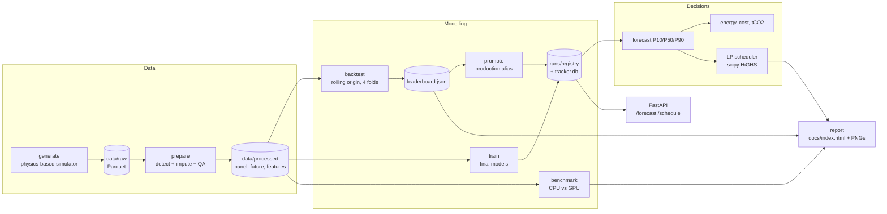

# Architecture

`dcforecast` is a single Python package (`src/dcforecast`) with one CLI. Every pipeline step
reads its inputs from disk and writes its outputs to disk, so steps can be run one by one
(`generate`, `prepare`, `backtest`, `train`, `promote`, `benchmark`, `schedule`, `report`) or all
at once (`run-all`), and the API serves whatever the registry holds.

## Package layout

| Module | Responsibility |
|---|---|
| `config.py`, `configs/*.yaml` | Typed dataclass config; `default` and `tiny` profiles; env (`DCF__SECTION__KEY`) and `--set` overrides; cross-field validation (e.g. lags >= horizon) |
| `data/sites.py` | The six fictional sites and their physical parameters |
| `data/generate.py` | Weather, IT load, PUE, carbon intensity, tariff and forecast feeds ([data-generation.md](data-generation.md)) |
| `data/quality.py` | Fault injection, rule-based detection, causal imputation, QA report |
| `data/prepare.py` | Builds the clean panel, the known-future feed and the feature matrix |
| `features.py` | Calendar, holiday and Fourier terms; horizon-shifted lags and rolling statistics |
| `models/base.py` | `Forecaster` ABC (`fit / predict / save / load`), residual-quantile calibration |
| `models/baselines.py`, `ets.py`, `gbm.py` | Seasonal naive (24 h, 168 h), Holt-Winters, quantile gradient boosting |
| `models/deep/` | Window dataset, LSTM encoder-decoder and TCN, device selection, batch-size finder, training loop |
| `evaluation/` | Metrics (MAE, RMSE, MAPE, sMAPE, MASE, pinball, coverage) and the rolling-origin backtest |
| `tracking/` | SQLite tracker (runs, params, metrics, durations, device, git commit) and model registry with aliases |
| `benchmark.py`, `hardware.py` | CPU vs GPU throughput / latency / memory benchmark; anonymised hardware inventory; nvidia-smi + psutil sampler |
| `decision/` | P50 forecast -> energy, cost, carbon; PUE curve; LP scheduler; forecast-vs-realised audit |
| `api/` | FastAPI app and pydantic schemas |
| `report/` | Matplotlib PNGs and the Plotly / Jinja2 static HTML report |
| `pipeline.py`, `cli.py` | Orchestration (`run-all`) and the argparse CLI |

## The forecasting task

* **Target**: hourly facility power (kW) per site.
* **Issue time**: every day at 23:00 UTC (the last observed hour); horizons 1..24 h ahead.
* **Information set**: all measurements up to the issue time, plus day-ahead forecasts of
  weather and grid carbon intensity for the target hours (see
  [data-generation.md](data-generation.md#5-forecast-feeds-known-at-prediction-time)).
* **Output**: P10, P50, P90 for every site and horizon.

## Models

| Model | Idea | Uncertainty |
|---|---|---|
| Seasonal naive 24 h / 168 h | `y(t+h) = y(t+h-24)` or `y(t+h-168)` | empirical residual quantiles from the last 8 weeks |
| Holt-Winters (ETS) | statsmodels, damped additive trend, weekly seasonality, fitted on a 6-week trailing window per site; state re-filtered at every origin | residual quantiles from calibration origins |
| Gradient boosting | `HistGradientBoostingRegressor(loss="quantile")`, one global model per quantile, target relative to the trailing weekly level | native quantile loss |
| LSTM encoder-decoder | global multi-site model, site embedding; encoder reads 168 h of history, decoder runs over the 24 known-future steps (no autoregressive feedback) | 3-quantile pinball loss |
| TCN | causal dilated convolutions (receptive field 253 h) over the lookback, horizon embedding + known covariates in the head | 3-quantile pinball loss |

Deep models use instance normalisation (divide by the mean of the encoder window) so one
network serves sites of different size and growth; imputed targets are masked out of the loss.

## GPU training engineering

| Technique | Where |
|---|---|
| Device auto-detection CUDA -> MPS -> CPU, graceful fallback | `models/deep/device.py` |
| Automatic mixed precision (`torch.autocast` fp16 + `GradScaler`) on CUDA | `models/deep/trainer.py` |
| Pinned host memory + non-blocking copies | `trainer.make_loader`, `device.pin_memory` |
| Vectorised batch gathering (`__getitems__`), so DataLoader workers are optional | `models/deep/data.py` |
| `num_workers: auto` = 0 on Windows (spawned workers re-import torch: slow start, ~hundreds of MB RAM each), 2 elsewhere | `device.num_workers` |
| Gradient clipping, AdamW, OneCycle LR (cosine fallback for very short runs) | `trainer.train_model` |
| Early stopping on validation pinball loss, best-model checkpointing | `trainer.train_model` |
| Deterministic seeding (python, numpy, torch, cuDNN flags) | `utils.seed_everything` |
| VRAM-aware batch-size finder: doubles the batch from 64 while `1.25 x peak <= min(vram_budget_mb, 50 % of free VRAM)` | `models/deep/batch_size.py` |
| OOM-tolerant benchmark (halves the batch and retries) | `benchmark._benchmark_with_retry` |
| Warm starts: backtest folds 2..k and the final model fine-tune the previous weights | `evaluation/backtest.py`, `pipeline.train_models` |

## Evaluation

Rolling origin with 4 consecutive 28-day test windows at the end of the history. For each fold
every model is refit on all data before the window and forecasts each day of the window.
MASE and scaled pinball are normalised per site by the in-sample seasonal-naive (24 h) MAE of
that fold's training data, so large sites do not dominate. Imputed actuals are excluded from
scoring. The production alias is promoted to the registered model with the best backtest MASE.

## Decision layer

1. The production model forecasts the next 72 h for every site (P10/P50/P90). Horizons beyond
   24 h roll the 24 h model forward day by day using its own P50 as history; the P10-P90
   band of day k is widened by sqrt(k).
2. A per-site PUE-vs-temperature curve (fitted on the last year) converts weather forecasts into
   PUE for the extra deferrable load.
3. Energy, cost and emissions per site = forecast power x tariff / carbon-intensity forecast.
4. The LP (see `decision/scheduler.py`) places the deferrable batch energy into the cheapest or
   cleanest hours and, for the portable share, sites, under each site's power cap minus the
   P90 forecast. Plans: run immediately (baseline), carbon-optimal time-shift only,
   carbon-optimal with relocation, cost-optimal, blended (cost + carbon price).
5. Because the generator keeps the true future, every plan is also scored against the
   *realised* carbon intensity and PUE, so the reported savings are not an artefact of
   optimising against our own forecast.

## Serving

`dcforecast serve` starts uvicorn with the FastAPI app (`api/app.py`). The production model is
loaded lazily on the CPU (GPU optional via `serve.device`).

| Endpoint | Description |
|---|---|
| `GET /health` | status, version, production model, data range |
| `GET /models` | registry with versions, metrics and aliases |
| `GET /forecast?site=dunehaven&horizon=24` | P10/P50/P90 per hour plus energy, cost and tCO2 |
| `GET /schedule?deferrable_mwh=120&horizon_hours=72&objective=carbon` and `POST /schedule` | carbon- or cost-aware plan and savings vs running immediately |

## Design decisions and trade-offs

* **Synthetic but physical data.** Real multi-site data-center telemetry with carbon and tariff
  feeds is not public. A documented generator with known ground truth lets the project score
  the cleaning step, keep the true future for decision audits and stay fully reproducible.
* **Files + SQLite instead of MLflow / a database server.** Zero services to run, works in CI
  and on a laptop, and the schema is small enough to read in one screen.
* **One global deep model** instead of one per site: more training data per parameter, and new
  sites only need an embedding row.
* **Direct multi-horizon decoding** (all 24 h at once) avoids error accumulation and makes
  training and inference identical.
* **LP rather than greedy scheduling.** With per-site power caps, relocation and a pool rate
  limit, greedy "fill the cleanest hour first" is not optimal; HiGHS solves the
  6 sites x 72 h problem in milliseconds.
* **CPU serving by default.** Single-request inference is ~ms on the CPU; keeping the GPU free
  for training is the better trade-off on a 4 GB laptop GPU.
* **A known platform quirk.** On Windows with torch 2.11 the fused multi-layer cuDNN LSTM with
  inter-layer dropout crashed the interpreter at exit (0xC0000409) after a successful run; the
  LSTM is therefore built from single-layer cuDNN LSTMs with dropout in between
  (`networks.StackedLSTM`), which is mathematically the same model.
